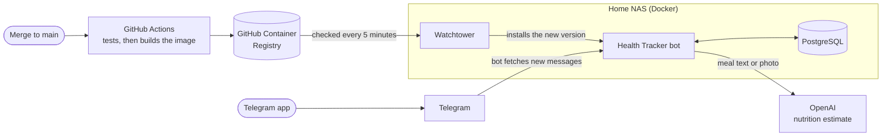

  

<h1 align="center">Health Tracker</h1>

  A private Telegram bot for logging weight, meals and daily calories, self-hosted on a home NAS. 
  Describe a meal or snap a photo, and it estimates calories and macros for you.

  
  

   
  A dinner reminder, a meal photo, then 📋 Today and 📈 Progress. <a href="assets/videos/health-tracker-trailer.mp4">Watch the full-quality video</a>.

## Features

- **Meals from text or photos.** Type "chicken rice, less rice" or send a picture. The bot estimates calories, protein, carbs and fat, and nothing is saved until you check it and tap Save.
- **Weight and daily totals.** 📋 Today shows meals and calories against your own target. 📈 Progress charts the last 7 days, 30 days or all time.
- **Gentle reminders** for breakfast, lunch and dinner, sent only if that meal hasn't been logged yet.
- **Fix mistakes:** edit a saved meal by retyping it, or delete it. Logging your weight again the same day replaces it.
- **Your data, your time:** `/export` downloads everything as a spreadsheet, and `/timezone` makes your day and reminders follow your own clock.
- **Invite-only.** New people tap *Request access*, and the owner approves or rejects them inside Telegram.

| Meal estimate | Today | Progress |
| :---: | :---: | :---: |
| *Screenshot placeholder* | *Screenshot placeholder* | *Screenshot placeholder* |

New to the bot? The [user guide](docs/user-guide.md) walks through every option.

## How it's hosted

The bot runs in Docker on my home NAS:

- The bot **fetches messages from Telegram** itself, so nothing needs to be exposed: no open ports and no public address on my home network.
- **PostgreSQL** on the same NAS stores every record, and the records never leave it. Meal descriptions and photos are sent to **OpenAI** for estimates.
- Merging to `main` makes **GitHub Actions** run the tests and, only if they pass, build the image for Intel and ARM and publish it to the GitHub Container Registry.
- **Watchtower** on the NAS notices the new image and restarts the bot with it. Releases (`1.0`, `1.0.1`, …) give other people a version to pin.

## Engineering highlights

- **Predictable AI costs.** Per-user and bot-wide quotas, a cap on calls running at once, and input size limits stop one person (or a stuck keyboard) from running up the OpenAI bill. Daily counters survive restarts.
- **Responsive under load.** Different users are served in parallel, but each user's messages are handled one at a time, so a double-tapped *Save* can't log a meal twice. Database work runs off the event loop.
- **Structured, validated estimates.** OpenAI returns a typed response that's range-checked before anyone sees it.
- **Safe access control.** Approvals happen in Telegram. *Approve*, *Reject* and *Remove* buttons each carry a one-time token, so an old or double-tapped button can't act on a newer request. Sign-up spam is rate-limited.
- **Time zones done properly.** Each user's "today" and reminder times follow their own timezone, including 23- and 25-hour daylight-saving days.
- **Tests gate every deploy.** More than 120 offline tests (in-memory database, mocked Telegram and OpenAI) run in CI. A failing test stops the image from being published, so a broken commit never reaches the NAS.
- **Hardened container.** The bot runs as a non-root user with read-only code. The updater, which can control Docker, is pinned by version and digest. Dependabot proposes weekly dependency updates.

## Privacy

- Records (users, meals, weights, reminders, access grants) are stored only in PostgreSQL on the owner's NAS. Meal photos aren't saved; only Telegram's reference to them is.
- Messages pass through Telegram, and meal descriptions and photos are sent to OpenAI to make estimates.
- Users see only their own data. The admin tools manage access; they can't open anyone's health log.
- Anyone can download their own data with `/export`.
- Nutrition values are AI estimates and are approximate.

## Run your own

You need a machine that runs Docker (it's built and tested on a UGREEN NAS), a Telegram bot token and an OpenAI API key. The ready-made image is pinned to a release, so you receive bug fixes automatically and choose when to take new features. Developers can fork it instead and have their own changes deployed the same way.

**[Setup guide →](docs/setup.md)**
